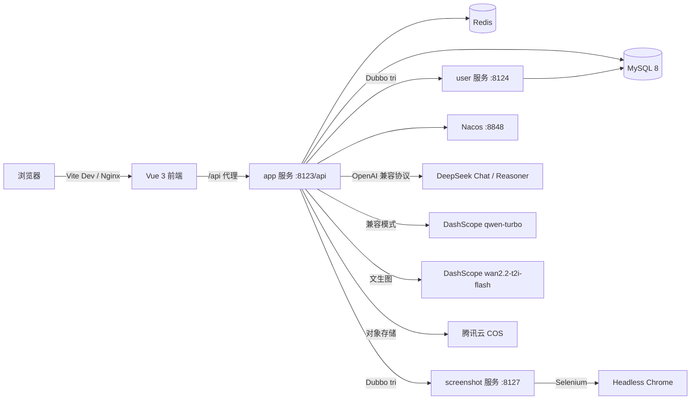

# AI Coding Platform · AI 应用生成平台

> 一句话描述：用户只需输入一句自然语言需求，平台即可通过 AI 自动完成「需求理解 → 代码生成 → 文件落盘 → 项目构建 → 一键部署 → 在线预览」的完整闭环。

[](https://openjdk.org/)
[](https://spring.io/projects/spring-boot)
[](https://vuejs.org/)
[](https://vite.dev/)
[](#许可证)

---

## 目录

- [项目亮点](#项目亮点)
- [系统架构](#系统架构)
- [技术栈](#技术栈)
- [目录结构](#目录结构)
- [环境要求](#环境要求)
- [快速开始](#快速开始)
  - [1. 克隆代码](#1-克隆代码)
  - [2. 初始化数据库](#2-初始化数据库)
  - [3. 启动 Redis](#3-启动-redis)
  - [4. 配置后端](#4-配置后端)
  - [5. 启动后端（单体模式）](#5-启动后端单体模式)
  - [6. 启动后端（微服务模式，可选）](#6-启动后端微服务模式可选)
  - [7. 启动前端](#7-启动前端)
- [配置项说明](#配置项说明)
- [接口文档与监控](#接口文档与监控)
- [核心功能说明](#核心功能说明)
- [常见问题](#常见问题)
- [生产部署检查清单](#生产部署检查清单)
- [安全说明](#安全说明)

---

## 项目亮点

### AI 全流程自动化

- **一句话生成应用**：输入需求描述即自动创建应用，并由 AI 智能判断应使用「原生 HTML / 多文件 / Vue 工程」中的哪种生成模式。
- **智能模型路由**：通过轻量模型（`qwen-turbo`）做意图分类与生成类型路由，重任务交给 `deepseek-chat` / `deepseek-reasoner`，在效果与成本之间取得平衡。
- **SSE 流式输出**：代码生成过程实时推送到前端，边生成边展示，避免长时间白屏等待。
- **多文件代码解析与落盘**：自动解析 AI 返回的多文件结构，安全写入磁盘，支持增量修改与对话式迭代。

### 从代码到上线的完整闭环

- **Vue 工程构建**：对 `vue_project` 类型自动执行 `npm install` + `npm run build`，产出可部署静态资源。
- **一键部署**：生成唯一 6 位 `deployKey`，将产物复制到部署目录并通过 `/api/static/**` 对外提供访问。
- **应用截图**：基于 Selenium + WebDriverManager 自动截图生成应用封面，未配置对象存储时自动跳过，不阻塞主流程。
- **在线预览与对话编辑**：应用详情页可直接预览生成结果，并继续通过对话修改代码。

### 工程质量与安全设计

- **双重架构支持**：既可作为单体快速启动，也提供 `Spring Cloud Alibaba + Dubbo 3(tri) + Nacos` 微服务版本。
- **接口限流**：基于 Redisson 的注解式限流（`@RateLimit`），保护 AI 生成等高成本接口。
- **缓存优化**：精选应用列表分页缓存（Caffeine/Redis），管理员变更时自动失效，避免 N+1 查询。
- **安全加固**：XSS 净化（DOMPurify）、排序字段白名单防 SQL 注入、静态资源路径穿越校验、SSE 连接自动关闭。
- **可观测性**：Spring Actuator + Prometheus 指标，AI 调用上下文（用户/应用维度）贯穿链路。

### 现代化前端体验

- Vue 3 + TypeScript + Vite 8 + Ant Design Vue，Pinia 状态管理，路由级权限控制。
- Markdown 渲染 + 代码高亮 + XSS 防护，移动端响应式布局。
- 完整的用户中心、管理员后台（用户管理 / 应用管理 / 对话管理）。

---

## 系统架构



**服务与端口一览**

| 模块 | 服务名 | HTTP 端口 | Dubbo tri 端口 | 说明 |
| --- | --- | --- | --- | --- |
| `AICodingPlatform`（根模块） | `AICodingPlatform` | 8123（`/api`） | - | 单体模式，全部功能 |
| `AICodingPlatform-app` | `aicoding-platform-app` | 8123（`/api`） | 50053 | 微服务网关入口、应用与对话 |
| `AICodingPlatform-user` | `aicoding-platform-user` | 8124（`/api`） | 50051 | 用户与权限 |
| `AICodingPlatform-screenshot` | `AICodingPlatform-screenshot` | 8127（`/api`） | 50052 | 网页截图 |
| `AICodingPlatform-ai` | - | - | - | AI 能力库模块（无独立端口） |
| 前端 | `aicodingplatform-frontend` | 5173（开发） | - | Vite Dev Server |

---

## 技术栈

**后端**

| 类别 | 技术 |
| --- | --- |
| 语言 / 运行时 | Java 21 |
| 框架 | Spring Boot 4.1.0（单体）/ Spring Boot 3.5.3（微服务） |
| ORM | MyBatis-Flex 1.11.x |
| 数据库 / 连接池 | MySQL 8、HikariCP |
| 缓存 / 会话 | Redis、Spring Session、Redisson、Caffeine |
| AI 框架 | LangChain4j 1.18.1-beta28、LangGraph4j |
| 大模型 | DeepSeek `deepseek-chat` / `deepseek-reasoner`、DashScope `qwen-turbo`、`wan2.2-t2i-flash` |
| 微服务 | Spring Cloud Alibaba、Dubbo 3.3（tri 协议）、Nacos 2.x |
| 文档 / 监控 | Knife4j 4.4.0（OpenAPI 3）、Spring Actuator、Micrometer Prometheus |
| 其他 | Hutool、Selenium 4 + WebDriverManager、腾讯云 COS SDK |

**前端**

| 类别 | 技术 |
| --- | --- |
| 框架 | Vue 3.5 + TypeScript |
| 构建 | Vite 8、vue-tsc |
| UI | Ant Design Vue 4 |
| 状态 / 路由 | Pinia、Vue Router |
| 请求 | Axios |
| 内容渲染 | marked、highlight.js、DOMPurify |
| 质量工具 | oxlint、ESLint、Prettier |

---

## 目录结构

```text
AICodingPlatform/
├── src/                              # 单体后端源码
│   ├── main/java/com/haoyuan/aicodingplatform/
│   │   ├── ai/                       # AI 服务、模型路由、工具调用
│   │   ├── aop/                      # 鉴权、日志等切面
│   │   ├── config/                   # 配置类（Redis、CORS、AI 模型等）
│   │   ├── controller/               # 接口层
│   │   ├── core/                     # 代码生成核心
│   │   │   ├── builder/              # Vue 工程构建
│   │   │   ├── handler/              # 流式消息处理
│   │   │   ├── parser/               # HTML / 多文件代码解析
│   │   │   └── saver/                # 代码文件落盘
│   │   ├── langgraph4j/              # LangGraph4j 编排
│   │   ├── manager/                  # 外部能力封装（COS、截图等）
│   │   ├── mapper/                   # MyBatis-Flex Mapper
│   │   ├── model/                    # 实体、DTO、VO、枚举
│   │   ├── monitor/                  # AI 调用监控上下文
│   │   ├── ratelimiter/              # Redisson 限流注解与切面
│   │   └── service/                  # 业务服务
│   └── main/resources/
│       ├── application.yml           # 基础配置（可提交）
│       ├── application-local.yml     # 本地配置（已在 .gitignore 中忽略）
│       └── prompts/                  # AI 提示词模板
├── AICodingPlatform-microservice/    # 微服务版本（Maven 多模块）
│   ├── AICodingPlatform-common/      # 公共响应、异常、工具
│   ├── AICodingPlatform-model/       # 实体与契约对象
│   ├── AICodingPlatform-client/      # Dubbo 接口定义
│   ├── AICodingPlatform-user/        # 用户服务
│   ├── AICodingPlatform-app/         # 应用主服务
│   ├── AICodingPlatform-screenshot/  # 截图服务
│   └── AICodingPlatform-ai/          # AI 能力库
├── AICodingPlatform-frontend/        # Vue 3 前端
│   ├── src/
│   │   ├── pages/                    # 页面（首页、应用、用户、管理后台）
│   │   ├── components/               # 通用组件
│   │   ├── stores/                   # Pinia
│   │   ├── access/                   # 路由权限
│   │   └── request.ts                # Axios 封装
│   └── vite.config.ts                # 开发代理配置
├── sql/create_table.sql              # 数据库初始化脚本
├── pom.xml                           # 单体后端 POM
├── mvnw / mvnw.cmd                   # Maven Wrapper
├── 上线前质量检查报告.md              # 质量检查与风险清单
└── README.md
```

---

## 环境要求

| 组件 | 版本要求 | 是否必需 |
| --- | --- | --- |
| JDK | 21+ | 必需 |
| Maven | 3.9+（或使用自带 `mvnw`） | 必需 |
| Node.js | `^22.18.0` 或 `>=24.12.0` | 必需（前端） |
| MySQL | 8.0+ | 必需 |
| Redis | 7.0+ | 必需（Session 存储） |
| Nacos | 2.x | 仅微服务模式 |
| Chrome | 最新稳定版 | 截图功能（可选） |
| npm / pnpm / yarn | npm 10+ | 前端包管理 |

> 建议使用 IntelliJ IDEA 2024.3+ / VS Code 进行开发。

---

## 快速开始

### 1. 克隆代码

```bash
git clone https://github.com/HaoyuanHE25/AI-Coding-platform.git
cd AI-Coding-platform
```

### 2. 初始化数据库

登录 MySQL 后执行：

```bash
mysql -u root -p < sql/create_table.sql
```

脚本会创建 `ai_coding_platform` 数据库以及 `user`、`app`、`chat_history` 三张表。

### 3. 启动 Redis

```bash
# Windows（安装包/服务方式启动后通常已常驻）
redis-server

# macOS
brew services start redis

# Linux
sudo systemctl start redis
```

默认连接 `localhost:6379`、无密码、`database 0`。若与默认值不同，修改 `application.yml` 中的 `spring.data.redis.*` 或用环境变量覆盖。

### 4. 配置后端

`application-local.yml` 已被 `.gitignore` 忽略，克隆后需要手动创建：

```bash
# 仓库根目录
src/main/resources/application-local.yml
```

**单体模式**配置模板（请替换为你自己的密钥，**切勿提交到仓库**）：

```yaml
langchain4j:
  open-ai:
    chat-model:
      base-url: https://api.deepseek.com
      api-key: ${DEEPSEEK_API_KEY}
      model-name: deepseek-chat
      timeout: 60s
      max-tokens: 8192
      max-tries: 3
    reasoning-streaming-chat-model:
      base-url: https://api.deepseek.com
      api-key: ${DEEPSEEK_API_KEY}
      model-name: deepseek-reasoner
      max-tokens: 32768
      temperature: 0.1
    routing-chat-model:
      base-url: https://dashscope.aliyuncs.com/compatible-mode/v1
      api-key: ${DASHSCOPE_API_KEY}
      model-name: qwen-turbo
      max-tokens: 100

cos:
  client:
    host: ${COS_HOST}
    secretId: ${COS_SECRET_ID}
    secretKey: ${COS_SECRET_KEY}
    region: ${COS_REGION}
    bucket: ${COS_BUCKET}

pexels:
  api-key: ${PEXELS_API_KEY}

dashscope:
  api-key: ${DASHSCOPE_API_KEY}
  image-model: wan2.2-t2i-flash

logging:
  level:
    com.haoyuan.aicodingplatform: info
```

Windows PowerShell 临时设置环境变量（当前窗口有效）：

```powershell
$env:DEEPSEEK_API_KEY = "sk-你的DeepSeekKey"
$env:DASHSCOPE_API_KEY = "sk-你的DashScopeKey"
$env:COS_HOST = "https://your-bucket.cos.ap-guangzhou.myqcloud.com"
$env:COS_SECRET_ID = "你的SecretId"
$env:COS_SECRET_KEY = "你的SecretKey"
$env:COS_REGION = "ap-guangzhou"
$env:COS_BUCKET = "your-bucket"
$env:PEXELS_API_KEY = "你的PexelsKey"
```

macOS / Linux：

```bash
export DEEPSEEK_API_KEY="sk-..."
export DASHSCOPE_API_KEY="sk-..."
export COS_HOST="https://your-bucket.cos.ap-guangzhou.myqcloud.com"
export COS_SECRET_ID="..."
export COS_SECRET_KEY="..."
export COS_REGION="ap-guangzhou"
export COS_BUCKET="your-bucket"
export PEXELS_API_KEY="..."
```

> 说明：
> - 最低可用配置只需 `DEEPSEEK_API_KEY`（代码生成）与 `DASHSCOPE_API_KEY`（智能路由 / 文生图）。
> - `COS_*` 未配置时，截图上传会跳过，不影响代码生成与部署。
> - 仓库根目录与微服务模块下均有 `application-local.yml`，两者都需要独立配置。

### 5. 启动后端（单体模式）

Windows：

```powershell
.\mvnw.cmd spring-boot:run
```

macOS / Linux：

```bash
./mvnw spring-boot:run
```

或先打包再运行：

```bash
./mvnw clean package -DskipTests
java -jar target/AICodingPlatform-0.0.1-SNAPSHOT.jar
```

启动成功后：

- 接口根路径：`http://localhost:8123/api`
- 健康检查：`http://localhost:8123/api/actuator/health`
- 接口文档：`http://localhost:8123/api/doc.html`

### 6. 启动后端（微服务模式，可选）

微服务版本使用 `Spring Boot 3.5.3 + Dubbo 3.3(tri) + Nacos`，与单体版本代码独立。

**步骤一：启动 Nacos**

```bash
# 下载 Nacos 2.x 后，单机模式启动
sh startup.sh -m standalone        # Linux / macOS
startup.cmd -m standalone          # Windows
```

默认地址 `http://127.0.0.1:8848`，账号密码 `nacos / nacos`。若修改，需要同步调整各模块 `application.yml` 中：

```yaml
dubbo:
  registry:
    address: nacos://127.0.0.1:8848?username=nacos&password=nacos
```

**步骤二：配置微服务本地环境**

在以下模块下分别创建 `application-local.yml`（均已被 `.gitignore` 忽略）：

```text
AICodingPlatform-microservice/AICodingPlatform-app/src/main/resources/
AICodingPlatform-microservice/AICodingPlatform-user/src/main/resources/
AICodingPlatform-microservice/AICodingPlatform-screenshot/src/main/resources/
```

微服务版本推荐全部使用环境变量占位符，例如：

```yaml
langchain4j:
  open-ai:
    chat-model:
      base-url: https://api.deepseek.com
      api-key: ${DEEPSEEK_API_KEY}
      model-name: deepseek-chat

dashscope:
  api-key: ${DASHSCOPE_API_KEY}

cos:
  client:
    host: ${COS_HOST}
    secret-id: ${COS_SECRET_ID}
    secret-key: ${COS_SECRET_KEY}
    region: ${COS_REGION}
    bucket: ${COS_BUCKET}

pexels:
  api-key: ${PEXELS_API_KEY}
```

**步骤三：按依赖顺序启动**

```bash
cd AICodingPlatform-microservice

# 1) 用户服务 8124 / 50051
mvn -pl AICodingPlatform-user -am spring-boot:run

# 2) 截图服务 8127 / 50052
mvn -pl AICodingPlatform-screenshot -am spring-boot:run

# 3) 应用主服务 8123 / 50053
mvn -pl AICodingPlatform-app -am spring-boot:run
```

Windows 下将 `mvn` 换成 `.\mvnw.cmd`（在微服务目录中执行 `../mvnw.cmd` 亦可）。

**步骤四：验证注册**

在 Nacos 控制台「服务管理 → 服务列表」中应能看到三个服务实例；调用统一走 app 服务 `http://localhost:8123/api`。

### 7. 启动前端

```bash
cd AICodingPlatform-frontend
npm install          # 或 pnpm install / yarn
npm run dev
```

访问 `http://localhost:5173`。

开发代理已在 `vite.config.ts` 中配置：`/api` → `http://localhost:8123`，因此前端请求统一写 `/api/...`，无需配置跨域。

生产构建：

```bash
npm run build        # 类型检查 + 构建，产物在 dist/
npm run preview      # 本地预览生产构建
```

质量检查命令：

```bash
npm run type-check   # vue-tsc 类型检查
npm run lint         # oxlint + eslint
npm run format       # prettier 格式化
```

---

## 配置项说明

### 基础配置（`application.yml`，可提交）

| 配置项 | 默认值 | 说明 |
| --- | --- | --- |
| `server.port` | `8123` | 后端 HTTP 端口 |
| `server.servlet.context-path` | `/api` | 全局接口前缀 |
| `spring.datasource.url` | `jdbc:mysql://localhost:3306/ai_coding_platform` | MySQL 连接 |
| `spring.data.redis.host/port` | `localhost` / `6379` | Redis 连接 |
| `spring.session.store-type` | `redis` | Session 存 Redis，支持多实例 |
| `spring.session.timeout` | `2592000` | Session 30 天过期 |
| `code.deploy-host` | `http://localhost:8123/api/static` | 部署后应用访问地址前缀，生产必须覆盖 |
| `knife4j.enable` | `true` | 接口文档开关，生产建议关闭 |
| `management.endpoints.web.exposure.include` | `health,info,prometheus` | Actuator 暴露端点 |

### 环境变量

| 环境变量 | 必需 | 用途 |
| --- | --- | --- |
| `DEEPSEEK_API_KEY` | 是 | 代码生成、推理模型 |
| `DASHSCOPE_API_KEY` | 是 | 智能路由（qwen-turbo）、文生图 |
| `COS_HOST` | 否 | 腾讯云 COS 访问域名 |
| `COS_SECRET_ID` | 否 | 腾讯云 COS SecretId |
| `COS_SECRET_KEY` | 否 | 腾讯云 COS SecretKey |
| `COS_REGION` | 否 | COS 地域，如 `ap-guangzhou` |
| `COS_BUCKET` | 否 | COS 存储桶名 |
| `PEXELS_API_KEY` | 否 | 应用封面配图 |
| `CODE_DEPLOY_HOST` | 生产必需 | 部署应用的对外访问地址 |

### 其他配置

| 配置项 | 说明 |
| --- | --- |
| `langchain4j.open-ai.chat-model` | 主模型（`deepseek-chat`），代码生成使用 |
| `langchain4j.open-ai.reasoning-streaming-chat-model` | 推理模型（`deepseek-reasoner`），复杂任务 |
| `langchain4j.open-ai.routing-chat-model` | 轻量路由模型（`qwen-turbo`），token 上限 100 |
| `dashscope.image-model` | 文生图模型，默认 `wan2.2-t2i-flash` |
| `mybatis-flex.configuration.log-impl` | SQL 日志，本地调试开启，生产关闭 |

生成产物目录（相对启动工作目录）：

```text
tmp/code_output/      # AI 生成的代码（如 html_1、vue_project_1）
tmp/code_deploy/      # 部署后的产物
```

---

## 接口文档与监控

| 地址 | 说明 |
| --- | --- |
| `http://localhost:5173` | 前端页面 |
| `http://localhost:8123/api/doc.html` | Knife4j 接口文档 |
| `http://localhost:8123/api/actuator/health` | 健康检查 |
| `http://localhost:8123/api/actuator/info` | 应用信息 |
| `http://localhost:8123/api/actuator/prometheus` | Prometheus 指标 |

> 重新生成前端接口类型（可选）：

```bash
cd AICodingPlatform-frontend
npm run openapi2ts
```

---

## 核心功能说明

### 应用生成流程

1. 用户输入需求 → 创建应用（`/app/add`）。
2. AI 路由服务判断生成类型：
   - `html`：单文件原生 HTML，适合简单页面；
   - `multi_file`：HTML + CSS + JS 多文件结构；
   - `vue_project`：完整 Vue 工程，支持 npm 构建。
3. 对话生成（`/app/chat/gen/code`）通过 SSE 推送代码流，同时解析并保存到 `tmp/code_output/{type}_{appId}`。
4. 对话记录写入 `chat_history`，支持继续对话修改。
5. 部署（`/app/deploy`）执行构建（Vue 工程）→ 复制产物 → 生成 `deployKey` → 返回访问地址。
6. 应用详情页预览，并通过截图服务生成封面。

### 权限模型

| 角色 | 权限 |
| --- | --- |
| 游客 | 浏览首页精选应用、注册、登录 |
| 用户 | 创建/编辑/删除自己的应用、对话生成、部署、个人中心 |
| 管理员 | 用户管理、应用管理（精选设置）、对话管理、删除任意应用 |

### 内置质量保障

- 排序字段白名单，防止 SQL 注入；
- 静态资源路径 `canonicalPath` 校验，防止路径穿越；
- Markdown 渲染经 DOMPurify 净化，防止 XSS；
- SSE 连接在完成、异常、组件卸载时主动关闭，避免连接泄漏；
- 分页大小强制上限（应用列表每页最多 20 条）。

---

## 常见问题

**Q1：启动报 `Unable to connect to Redis` / `Connection refused: localhost:6379`**

Redis 未启动或地址不正确。先确认 `redis-cli ping` 返回 `PONG`，再检查 `spring.data.redis.host/port`。Session 使用 Redis 存储，Redis 不可用时应用无法启动。

**Q2：启动报数据库连接失败**

确认 MySQL 已启动、`ai_coding_platform` 库已创建，账号密码与 `application.yml` 一致。可先用命令行验证：

```bash
mysql -u root -p -e "use ai_coding_platform; show tables;"
```

**Q3：生成代码时报模型调用失败**

- 检查 `DEEPSEEK_API_KEY` 是否有效、账户是否有余额；
- `deepseek-reasoner` 会先输出推理内容，若 `max-tokens` 过小可能导致正文为空，保持默认 `32768`；
- 代码生成应使用 `deepseek-chat`，不要随意切换为推理模型。

**Q4：Vue 工程生成后部署失败**

`vue_project` 类型需要本机可执行 `npm`。确认 Node 版本满足 `^22.18.0 || >=24.12.0`，并保证 `npm install` 能正常访问镜像源。

**Q5：应用部署后访问 404**

检查 `CODE_DEPLOY_HOST` 是否与真实访问地址一致（默认 `http://localhost:8123/api/static`）。生产环境必须设置为外部可访问的域名，且反向代理需正确转发 `/api/static/**`。

**Q6：前端请求 404 / 跨域**

开发环境依赖 Vite 代理。确认后端运行在 `8123` 且 `vite.config.ts` 中 `target` 一致；不要直接用 `file://` 打开 `index.html`。

**Q7：微服务启动报 Dubbo / Nacos 相关错误**

- 确认 Nacos 已在 `8848` 启动并完成登录；
- 三个服务需按 user → screenshot → app 顺序启动；
- 本地同时启动多个服务时已关闭 Dubbo QoS 端口（`qos-enable: false`），避免冲突；
- 端口冲突时检查 `50051/50052/50053` 与 `8123/8124/8127`。

**Q8：截图功能报 Chrome / Driver 错误**

截图依赖 Selenium + WebDriverManager，需要本机安装 Chrome，且能联网下载 driver。未配置 COS 时会跳过上传，不影响主流程。

**Q9：接口文档打不开**

确认访问的是 `/api/doc.html`（带 context-path），并检查 `knife4j.enable=true`。

**Q10：`application-local.yml` 修改后不生效**

确认 `spring.profiles.active=local`，且文件位于对应模块的 `src/main/resources/` 下；修改后需重启应用。

---

## 生产部署检查清单

- [ ] 使用独立的生产数据库账号，禁止 `root`，并限制来源 IP
- [ ] 所有密钥通过环境变量或配置中心注入，仓库内不得出现明文密钥
- [ ] 设置 `CODE_DEPLOY_HOST` 为真实外部域名（HTTPS）
- [ ] 关闭或限制 Knife4j（`knife4j.enable=false`）与 Actuator 明细端点
- [ ] 前端使用 `npm run build` 产物，由 Nginx 托管并反向代理 `/api`
- [ ] 为 `/api/chat/**`、`/api/app/deploy` 等重接口配置限流
- [ ] 登录 / 注册接口增加验证码或频控
- [ ] Session Cookie 开启 `Secure`、`HttpOnly`，并限制 CORS 来源
- [ ] 配置日志轮转与错误告警，避免 AI 请求日志泄露敏感信息
- [ ] 备份 MySQL，并对 `tmp/code_output`、`tmp/code_deploy` 做容量监控
- [ ] 压测 SSE 长连接与并发部署场景，确认连接数上限
- [ ] 统一包管理器（`package-lock.json` 与 `yarn.lock` 只保留一个）

更完整的检查项与已知风险见 [上线前质量检查报告.md](./上线前质量检查报告.md)。

---

## 安全说明

1. **仓库不包含任何生产密钥**。`application-local.yml`、`application-prod.yml` 已加入 `.gitignore`，请勿强制提交。
2. 若曾将密钥提交到历史记录，请立即在对应平台轮换（DeepSeek、DashScope、腾讯云 COS、Pexels）。
3. 生产环境必须外置配置，推荐使用 Nacos 配置中心或环境变量注入。
4. 默认账号密码、`root/123456`、`nacos/nacos` 仅用于本地开发，生产必须修改。
5. 密码存储建议升级为 BCrypt / Argon2，并配合随机盐；当前实现仅适用于演示与学习。

---

## 许可证

本项目仅用于学习与技术实践。如需商用，请自行评估第三方服务（DeepSeek、DashScope、腾讯云 COS、Pexels）的服务条款与费用。

---

**作者**：Haoyuan · [GitHub](https://github.com/HaoyuanHE25)
